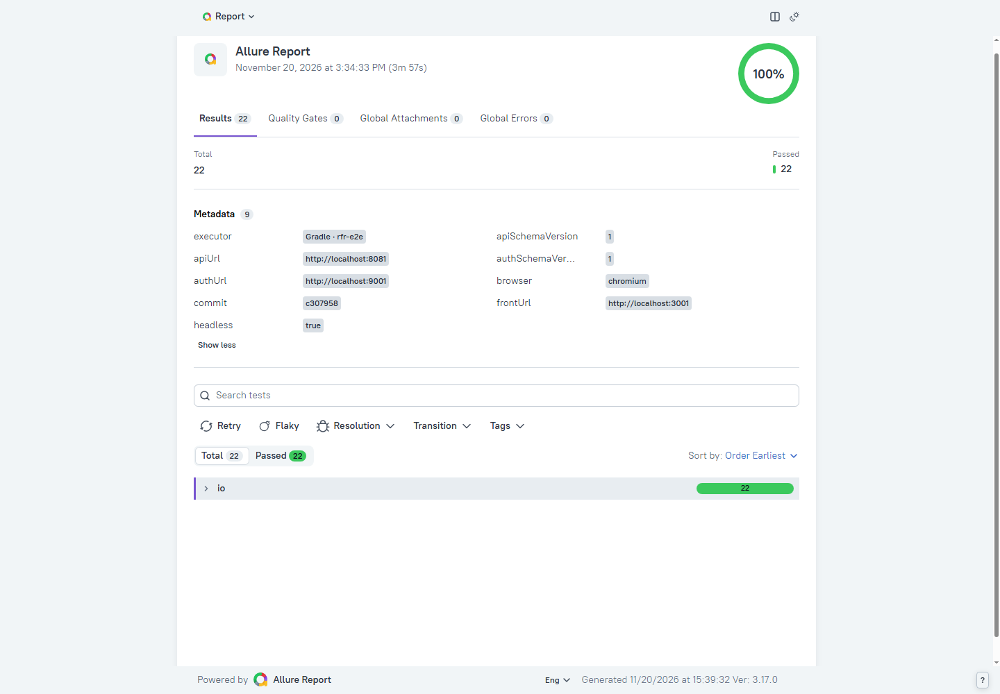

# Проверки ДЗ №04

## Сравнение способов подготовки

| Способ | Когда вызывается | Прямой запуск в IDEA | Контекст JUnit и теги | Ошибка подготовки |
|---|---|---|---|---|
| `SuiteExtension` через ServiceLoader | Первый подходящий `beforeAll`, один раз на корневой Store для каждой реализации | Да, у класса и метода; автодетект включён | Доступен `ExtensionContext`, до регистрации ресурса проверяется тег `ui` | Ошибка контейнера класса; тела тестов блокируются; уже зарегистрированный ресурс закрывается |
| `@BeforeSuite` | При выполнении suite-движка | Нет при прямом запуске Jupiter-класса или метода | Нет Jupiter Store; фильтры задаёт suite | `initializationError` suite; в опыте нет Allure test-result |
| `LauncherSessionListener` | При открытии launcher-сессии, до выполнения тестов | Да | Не получает Jupiter Store или контекст отдельного класса | Gradle: `Could not start Gradle Test Executor`; IDEA: `Internal Error occurred`, exit -2 |

Оставлен `SuiteExtension`: подготовка применяется к UI-классам, работает из IDEA и хранит закрываемый ресурс в корневом Store.

## Эксперимент 1: BeforeSuite

Коммит `92a14d8`, следующий коммит `9c6c219` — `git revert`.

- Suite-only: `@BeforeSuite` вызван один раз. Первая проверка: 22 теста, 20 прошли, два упали из-за русской локали auth; локаль исправлена отдельно в `892b9e7`.
- Без ограничения движков: 44 попытки выполнения 22 тестов. Первые 22 в suite прошли, вторые 22 в отдельном Jupiter-движке получили `Playwright connection closed` при разрешении `Page`. В Playwright 1.63 корневой ресурс закрывает драйвер, но статический ThreadLocal сохраняет ссылку; второй движок получает закрытый драйвер. Это результат намеренно неверной конфигурации, не успешные два прогона. Allure: 22 passed, 22 broken.
- Прямые JUnit-запуски IDEA: класс и метод прошли по одному тесту, хотя была задана копия миграции с неверной checksum. В выводе нет маркера BeforeSuite, UID начинается с Jupiter, не suite.
- `e2e --tests '*TabTest'`: BeforeSuite вызван один раз, затем `NoTestsDiscoveredException`, один `initializationError`, ноль тел UI-тестов. Allure создал два служебных файла, ноль test-result.
- Подмена только пути к копии auth-миграции: Flyway сообщил checksum mismatch v1, Gradle завершился с exit1, `initializationError`; ноль тел UI-тестов и Allure test-result. БД не изменяли: выполнялся validate, а не migrate.

## Эксперимент 2: LauncherSessionListener

Коммит `cd75cc0`, следующий коммит `ad71b0b` — `git revert`.

- `:rfr-e2e:test --tests '*SuiteExtensionTest'`: 22 проверки прошли; один маркер listener, PID4188. Вложенные запуски EngineTestKit новых маркеров не создали.
- `:rfr-e2e:test` с `maxParallelForks=2`: 64 выполненных проверки прошли, 36 внутренних мишеней отключены; два маркера, PID49952 и PID23464. Это отдельные launcher-сессии двух тестовых JVM, не один глобальный вызов на сборку.
- `:test` с принудительным migrationCheck и копией неверной миграции: exit1, `TestSuiteExecutionException`, `Could not start Gradle Test Executor`, checksum mismatch. Ноль обычных JUnit XML-тестов и свежих файлов Allure.
- IDEA JUnit, тот же checksum mismatch: один маркер PID34884, `Internal Error occurred`, `IllegalStateException`, exit -2, ноль тел тестов.

## Повторное использование замечаний ревью

Перенесены и проверены прежние исправления FileReader и локали. Проверка пустой вкладки Friends дополнена управляемой задержкой GetFriends: три теста Friends прошли, временное удаление ожидания дало одно ожидаемое падение; рабочее ожидание восстановлено. По свежим результатам найден ровно один оставленный ранее профиль этого теста, выполнена адресная очистка; контроль auth/API/friendship — 0/0/0.

## Итоговые расширения

В одном SPI-файле зарегистрированы Environment → Readiness → Schema. Environment должен первым записать ресурс в корневой Store: если следующий beforeAll упадёт, Store всё равно закроет уже зарегистрированный ресурс. Отдельная EngineTestKit-проба подтверждает, что afterSuite позднего, ещё не зарегистрированного расширения не вызывается.

Порядок ограничен тремя провайдерами из одного файла в classpath: [Java25 ServiceLoader](https://docs.oracle.com/en/java/javase/25/docs/api/java.base/java/util/ServiceLoader.html) определяет порядок по строкам provider-файла. В используемом JUnit6.1.3 ServiceLoaderUtils сохраняет последовательный stream, MutableExtensionRegistry регистрирует его через forEach в ArrayList. Утверждение не распространяется на произвольный порядок разных provider-файлов или модулей.

Проверки готовности совпадают с исходным скриптом: TCP MySQL, успешный HTTP auth/front без следования редиректам, завершённый HTTP-ответ GraphQL API независимо от статуса. Принудительный HTTP1.1 нужен локальному Vite: сравнительный Java-запрос получил200 по HTTP1.1 и timeout при попытке HTTP2 upgrade. На Windows фронтенд запущен командой `npm --prefix rfr-gql-client run dev -- --host 127.0.0.1`, поскольку Vite без host слушал толькоIPv6, а Java выбиралаIPv4 для localhost.

| Контроль | Фактический результат |
|---|---|
| Удалить повторный опрос | waitsForLateService красная; корректный цикл восстановлен. Подставной фронт начинает двухсекундный отсчёт после первого503, чтобы загрузка JVM не скрывала поломку |
| Environment после Schema + неверная копия миграции | Flyway checksum mismatch, 0 тел UI-тестов, environment.properties отсутствует в новом каталоге |
| Environment до Schema + та же копия | Та же ошибка; environment.properties существует, обе версии схем1 |
| MySQL остановлена | Ошибка readiness до тестов; Environment существует, обе версииunavailable; контейнер снова healthy, mysql-volume сохранён |
| Отдельный FriendsTabTest, фронт выключен, timeout10 | initializationError readiness называет rfr-gql-client; браузерные сценарии не исполнялись; Environment существует |
| Прямой JUnit из IDEA, фронт выключен, timeout10 | Class Configuration failed, исходный тест ignored, exit-1; сообщение readiness содержит только rfr-gql-client, а не ошибку Playwright |
| Фронт запущен после начала ожидания полного E2E | В журнале сначала Waiting for stand: rfr-gql-client, после запуска Vite — 22 passed, 0 failures/errors/skipped; 345,81с; Environment существует |
| Пробы замечаний ревью | API401, auth302 и реальный Allure writer без override — 3pass после исправлений |

Каталог Gradle задаётся через `allure.adapter.resultsDir`; плагин сам передаёт JVM-аргумент. Отдельный systemProperty приводил к дублированию и переопределению, из-за чего ранние скрипты искали Environment не там. Поэтому окончательные проверки порядка повторены в новых каталогах с явным контролем наличия файла; ранние проверки с неверным путём не засчитываются как доказательство отсутствия.

Два итоговых `:rfr-e2e:test`: по78 выполненных проверок без ошибок; 38 внутренних мишеней отключены при прямом обнаружении. Время92,00с и83,39с. Независимый ревьюер выполнил36 проверок расширений без ошибок за58с; подробности в [review.md](review.md).

Два итоговых `:rfr-e2e:e2e`: по22 passed, failures/errors/skipped0; время286,83с и257,39с. В обоих свежих каталогах Allure по22 успешных результата и Environment с commit=c307958, browser=chromium, headless=true, обе версии схем1. SQL-снимок после завершения: auth0, API0, friendship0 для учебных пользователей `rfr_`.

## Окружение в отчёте

Отчёт открыт через `:rfr-e2e:allureServe` с каталогом результатов второго итогового UI-прогона. В Allure Report3.17.0 содержимое `environment.properties` показывается в блоке **Metadata** вместе с executor. После Show more видны все8 ключей окружения; отчёт содержит22 успешных результата. Скриншот просмотрен, значения сверены с файлом результатов.

Доказательства локально сохранены в build/hw04-evidence; личный дневник и сырые логи не входят в Git. GitHub CI и публикация ветки ещё не выполнялись.
